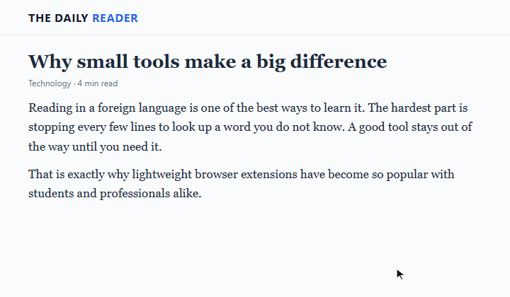

# Traduction Rapide

Extension Chrome qui traduit le texte surligné sur n'importe quelle page web et affiche le résultat dans une bulle, juste à côté de la sélection.

## Fonctionnalités

- **Traduction à la sélection** : surlignez un mot ou une phrase, la traduction apparaît dans une bulle.
- **Deux modes d'affichage** : traduction immédiate, ou petite icône à cliquer pour traduire.
- **Menu clic droit** : entrée « Traduire « … » » sur toute sélection.
- **Détection automatique** de la langue source et choix de la langue cible parmi 16 langues.
- **Copier et écouter** la traduction depuis la bulle.
- **Thème sombre** pris en charge automatiquement.

## Installation

L'extension n'est pas publiée sur le Chrome Web Store. Pour l'installer depuis les sources :

1. Clonez ce dépôt.
2. Ouvrez `chrome://extensions` dans Chrome (ou un navigateur basé sur Chromium).
3. Activez le **Mode développeur**.
4. Cliquez sur **Charger l'extension non empaquetée** et sélectionnez le dossier du dépôt.

## Utilisation

- Surlignez du texte sur une page : la bulle de traduction s'affiche.
- Changez la langue cible directement dans la bulle, ou dans la fenêtre de l'extension.
- Appuyez sur `Échap` ou cliquez ailleurs pour fermer la bulle.
- Cliquez sur l'icône de l'extension pour l'activer, la désactiver ou changer de mode.

## Structure

| Fichier | Rôle |
|---|---|
| `manifest.json` | Déclaration de l'extension (Manifest V3) |
| `content.js` | Détection de la sélection et affichage de la bulle dans un Shadow DOM |
| `background.js` | Service worker : appels de traduction et menu clic droit |
| `popup.html`, `popup.js` | Fenêtre de réglages |
| `languages.js` | Langues proposées et réglages par défaut |

## Confidentialité et limites

- Le texte surligné est envoyé au service Google Traduction pour être traduit. Désactivez l'extension ou utilisez le mode icône sur les pages contenant des données sensibles.
- L'extension utilise un point d'accès public non officiel de Google Traduction, qui peut être limité ou interrompu sans préavis.
- Les textes sont tronqués à 5 000 caractères.
